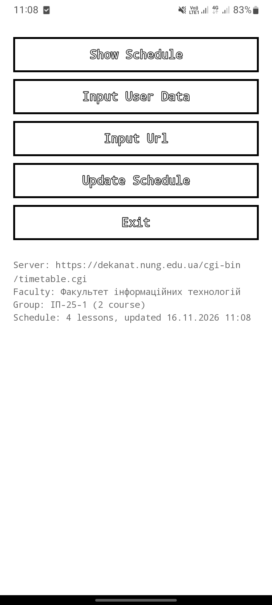
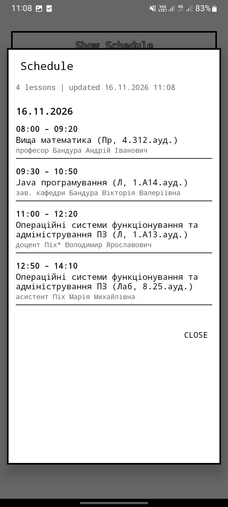

# AutoSchedule

An Android app that shows a university timetable and reminds you about lessons.

## Features

- Loads the schedule from the university server
- Shows the lessons of the current day
- Sends a notification 10 minutes before a lesson starts
- Refreshes the schedule automatically every day at 7:30

## Screenshots

| Main screen | Schedule |
|:---:|:---:|
|  |  |

## Build

```bash
./build.sh
```

The signed app is written to `app-signed.apk`. Android 8.0 or newer is required.
